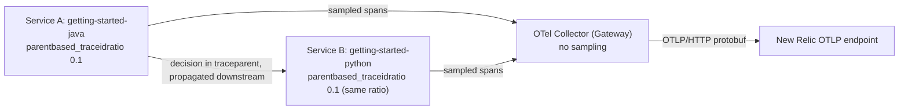

# Head sampling with the OpenTelemetry Operator

Builds on the [`operator`](../../operator) example. The only functional change is the `sampler` on the `Instrumentation` custom resource in [`manifests/04-instrumentation.yaml`](./manifests/04-instrumentation.yaml):

```yaml
sampler:
  type: parentbased_traceidratio
  argument: "0.1"
```

The Operator injects this as `OTEL_TRACES_SAMPLER` / `OTEL_TRACES_SAMPLER_ARG` into every instrumented pod. The SDK decides once, at the root span, and propagates the decision in the W3C `traceparent` sampled flag. Service A (Java) calls Service B (Python) on every request (`UPSTREAM_URL`, via a small overlay of the Java controller in [`apps/java`](./apps/java)), and B honours A's decision. Only sampled spans reach the Collector Gateway, which enriches and exports them to New Relic, so no extra infrastructure is needed.



## Out of scope

* Keeping 100% of error or slow traces. Head sampling decides before the outcome is known; use [`tail-sampling`](../tail-sampling).
* Hybrid setups with New Relic agents, and exporting without a Collector: see [`newrelic-head-sampling`](../newrelic-head-sampling).
* Metric and log sampling.

## Requirements

Same as the [`operator`](../../operator#requirements) example.

## Running the example

All commands run from this directory, against the kind cluster `nr-sampling-head`. See the [`operator` README](../../operator#running-the-example) for what each step does.

```shell
make cluster
cp .env.example .env
# Edit .env with your New Relic license key
make install
make build
make deploy
```

`make install` generates the gitignored `manifests/01-secrets.yaml` from `.env` (or an exported `NEW_RELIC_LICENSE_KEY`); to write it by hand instead, copy `manifests/01-secrets.yaml.template`. Clean up with `make clean`.

## Viewing your data

```shell
kubectl --context kind-nr-sampling-head port-forward -n otel-apps svc/getting-started-java 8081:8080 &
./scripts/generate-load.py
```

The load generator sends about 10 requests per second to Service A, roughly 10% of them with an out-of-range `n` that makes the app record an error span.

Measure the retained fraction. With a ratio of `0.1`, `traces` should be about 10% of the requests sent, and `error_traces` should be about 10% of the error requests, which shows head sampling is blind to errors:

```
FROM Span
SELECT uniqueCount(trace.id) AS traces, count(*) AS spans,
  filter(uniqueCount(trace.id), WHERE otel.status_code = 'ERROR') AS error_traces
WHERE service.name LIKE 'getting-started%'
FACET service.name SINCE 10 minutes ago
```

Check for fragmented traces. A trace that starts in Java must hold spans from both Java and Python, so a trace with only one service is fragmented. This should return `0` fragmented traces:

```
FROM (
  FROM Span SELECT uniqueCount(service.name) AS services
  WHERE service.name IN ('getting-started-java', 'getting-started-python')
  FACET trace.id LIMIT MAX
) SELECT filter(count(*), WHERE services < 2) AS fragmented_traces, count(*) AS traces
SINCE 10 minutes ago
```

Tested on minikube against New Relic: 500 requests to Service A (50 of them errors) kept 49 traces (9.8%), only 2 of which were error traces, and all 49 held both Java and Python spans (0 fragmented).

To change the rate, edit `argument` in the `Instrumentation` resource, run `make install`, and restart the app Deployments, because the sampler is injected when a pod is created.
