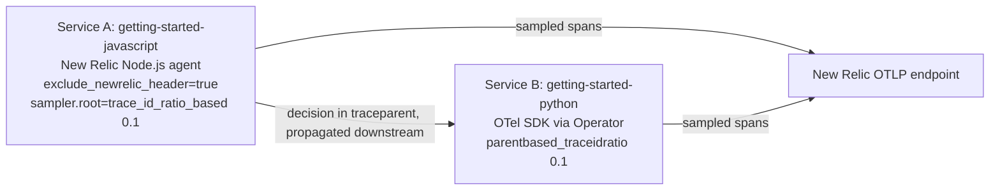

# Head sampling with New Relic agents and OpenTelemetry (no Collector)

Follows the "OpenTelemetry + New Relic - Head Sampling" diagram. Builds on the [`operator`](../../operator) example, without the Collector Gateway: every service sends its sampled spans straight to the New Relic OTLP endpoint.



1. Service A is the root and runs the New Relic Node.js agent, not an OTel SDK ([`apps/javascript`](./apps/javascript)). It is configured in [`manifests/apps/javascript.yaml`](./manifests/apps/javascript.yaml):
    * `NEW_RELIC_DISTRIBUTED_TRACING_EXCLUDE_NEWRELIC_HEADER=true`: W3C `traceparent` only, no legacy `newrelic` header.
    * `NEW_RELIC_DISTRIBUTED_TRACING_SAMPLER_ROOT=trace_id_ratio_based` and `..._RATIO_BASED_RATIO=0.1`: the ratio equivalent of Service B's sampler.
2. Service B is the Python app, instrumented by the Operator, with `parentbased_traceidratio` at `0.1` from [`manifests/04-instrumentation.yaml`](./manifests/04-instrumentation.yaml). It honours A's decision from `traceparent`.
3. Credentials live in a Secret in `otel-apps`, referenced by the pods, because there is no Collector to hold them.

Service A calls Service B on every request through a small overlay of `app.js` that reads `UPSTREAM_URL`.

## Why the Node.js agent

Not every New Relic agent can mirror an OTel ratio sampler and emit W3C-only headers. The Java agent has no ratio sampler, and the Python agent documents no `exclude_newrelic_header` option. The Node.js agent has both, so it can match the OTel services.

## Out of scope

* Tail sampling and error/latency retention: see [`tail-sampling`](../tail-sampling).
* Metric and log sampling.

## Requirements

Same as the [`operator`](../../operator#requirements) example.

## Running the example

All commands run from this directory, against the kind cluster `nr-sampling-nr-head`.

```shell
make cluster
cp .env.example .env
# Edit .env with your New Relic license key
make install
make build
make deploy
```

`make install` generates the gitignored `manifests/01-secrets.yaml` from `.env` (or an exported `NEW_RELIC_LICENSE_KEY`); to write it by hand instead, copy `manifests/01-secrets.yaml.template` and replace the `<INSERT_LICENSE_KEY>` placeholder, because `make install` fails while the placeholder remains. Clean up with `make clean`.

## Viewing your data

```shell
kubectl --context kind-nr-sampling-nr-head port-forward -n otel-apps svc/getting-started-javascript 8081:8080 &
./scripts/generate-load.py
```

Roughly 10% of requests should become traces in New Relic, with the same trace IDs in both services. The New Relic agent's spans carry the application name in `entity.name` (not `service.name`), so use `entity.name` for both:

```
FROM Span
SELECT uniqueCount(trace.id) AS traces, count(*) AS spans
WHERE entity.name IN ('getting-started-javascript', 'getting-started-python')
FACET entity.name SINCE 10 minutes ago
```

Check for fragmented traces. Every trace must hold spans from both services. This should return `0` fragmented traces:

```
FROM (
  FROM Span SELECT uniqueCount(entity.name) AS services
  WHERE entity.name IN ('getting-started-javascript', 'getting-started-python')
  FACET trace.id LIMIT MAX
) SELECT filter(count(*), WHERE services < 2) AS fragmented_traces, count(*) AS traces
SINCE 10 minutes ago
```

Tested on minikube against New Relic: 500 requests to Service A produced 40 traces (8%, within expected variance of 10%) in both services, with 0 fragmented. The agent's effective config showed `exclude_newrelic_header: true` and a root `trace_id_ratio_based` ratio of `0.1`. Data from the New Relic agent can take a few minutes to appear in full.
