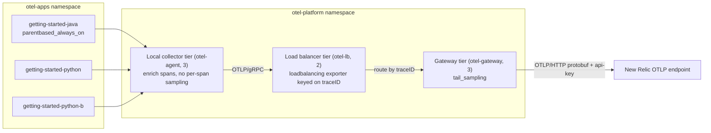

# Tail sampling with the OpenTelemetry Operator

Builds on the [`operator`](../../operator) example and follows the "OpenTelemetry Core - Tail Sampling" diagram of the Trace Sampling Reference Architecture: three Collector tiers between the instrumented services and New Relic.



1. The SDKs sample everything (`parentbased_always_on` in [`04-instrumentation.yaml`](./manifests/04-instrumentation.yaml)). Any head sampling here would hide dropped transactions from the gateway.
2. The local collector tier ([`03-collector-agent.yaml`](./manifests/03-collector-agent.yaml)) enriches spans with `k8s_attributes` and never drops them. Metrics and logs go straight to the gateway's Service; they need no trace-ID affinity.
3. The load balancer tier ([`03-collector-lb.yaml`](./manifests/03-collector-lb.yaml)) uses the `loadbalancing` exporter keyed on `traceID`. It resolves the gateway pods through the gateway's headless Service, so the same trace ID always reaches the same gateway instance.
4. The gateway tier ([`03-collector-gateway.yaml`](./manifests/03-collector-gateway.yaml)) runs `tail_sampling` after enrichment, with three policies evaluated after `decision_wait`:
    * `errors`: keep 100% of traces with an `ERROR` span.
    * `latency-outliers`: keep 100% of traces slower than 1000 ms.
    * `baseline`: keep 10% of the rest.

Without trace-ID affinity, the processor decides on partial traces and the result is silently wrong. This is the main failure mode to guard against.

The diagram draws the load balancer and gateway tiers in a separate Kubernetes cluster. Here all tiers share one cluster and are split by Deployment; the requirement is the tiers, not the number of clusters.

## Out of scope

* Sizing and autoscaling the gateway for production. `decision_wait`, `num_traces` and memory limits are examples; set them from your own p99 trace duration and traffic. The gateway has a fixed three replicas: scaling it changes the hash ring, so traces in flight during a scale event can be decided on partial data.
* Metric and log sampling.

## Requirements

Same as the [`operator`](../../operator#requirements) example. The `newrelic/nrdot-collector` image includes the `tail_sampling` processor and `loadbalancing` exporter.

## Running the example

All commands run from this directory, against the kind cluster `nr-sampling-tail`.

```shell
make cluster
cp .env.example .env
# Edit .env with your New Relic license key
make install
make build
make deploy
```

`make install` waits for the gateway, then the local collector tier, then the load balancer tier, before applying the `Instrumentation` resource. `make install` generates the gitignored `manifests/01-secrets.yaml` from `.env` (or an exported `NEW_RELIC_LICENSE_KEY`); to write it by hand instead, copy `manifests/01-secrets.yaml.template` and replace the `<INSERT_LICENSE_KEY>` placeholder, because `make install` fails while the placeholder remains. Clean up with `make clean`.

The load balancer's resolver needs RBAC to list `endpoints` and `endpointslices`, which [`02-collector-rbac.yaml`](./manifests/02-collector-rbac.yaml) grants. Without it the load balancer logs `endpointslices.discovery.k8s.io is forbidden` and has no gateway backends.

## Viewing your data

```shell
kubectl --context kind-nr-sampling-tail port-forward -n otel-apps svc/getting-started-java 8081:8080 &
kubectl --context kind-nr-sampling-tail port-forward -n otel-apps svc/getting-started-python 8082:8080 &
kubectl --context kind-nr-sampling-tail port-forward -n otel-apps svc/getting-started-python-b 8083:8080 &
./scripts/generate-load.py
```

About 10% of requests use an out-of-range `n`, so the apps record error spans, and about 5% of the requests to Java pass `delay_ms=1500` (an optional parameter added by the Java overlay in [`apps/java/Controller.java`](./apps/java/Controller.java)), so those traces are slower than the 1000 ms `latency-outliers` threshold. Java also calls Python on every request.

Every error trace should be retained, while healthy traces are kept at about 10%. Compare the error share here with the head-sampling example:

```
FROM Span
SELECT filter(count(*), WHERE otel.status_code = 'ERROR') AS 'error_spans', count(*) AS 'spans'
WHERE service.name IN ('getting-started-java', 'getting-started-python', 'getting-started-python-b')
FACET service.name SINCE 10 minutes ago
```

Check the gateway's own decisions, reported under `service.name = 'otel-gateway-collector'`:

```
FROM Metric
SELECT sum(otelcol_processor_tail_sampling_count_traces_sampled) AS traces
WHERE service.name = 'otel-gateway-collector'
FACET policy, sampled TIMESERIES
```

Check for fragmented traces. A trace that starts in Java must hold spans from both Java and Python, so a trace with only one service is fragmented. This should return `0` fragmented traces:

```
FROM (
  FROM Span SELECT uniqueCount(service.name) AS services
  WHERE service.name IN ('getting-started-java', 'getting-started-python')
  FACET trace.id LIMIT MAX
) SELECT filter(count(*), WHERE services < 2) AS fragmented_traces, count(*) AS traces
SINCE 10 minutes ago
```

Tested on kind against New Relic: 600 requests to Java (60 errors, 30 slow healthy requests with `delay_ms=1500`) kept 129 traces, including all 60 error traces and all 30 slow traces, with the rest kept at the 10% baseline.
